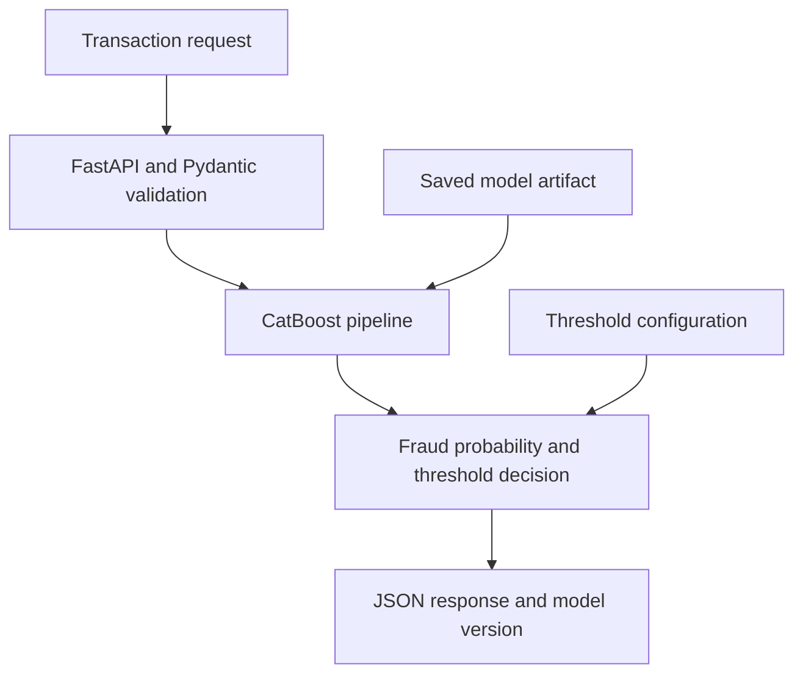
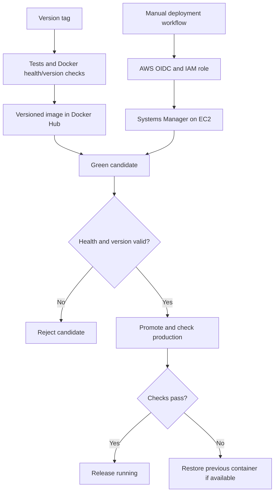

# 💳 Credit Card Fraud Detection API

An end-to-end machine learning engineering project that serves a CatBoost fraud classifier through FastAPI and packages it for versioned Docker releases and controlled deployment to AWS EC2.

    

[](https://github.com/IBOSS24/Fraud-detection-API/actions/workflows/ci.yml)

[Overview](#-project-overview) · [Architecture](#-architecture) · [Quick start](#-quick-start) · [API](#-api-reference) · [Deployment](#-ci-releases-and-aws-deployment) · [Author](#-author)

---

## 🎯 Project overview

Credit card fraud detection is an imbalanced binary classification problem: missed fraud and false alarms have different costs. This project connects model experimentation to an inference service with explicit decision thresholds, input validation, automated tests, and deployment checks.

The repository brings together model experimentation, a serialized pipeline, a validated inference API, automated tests, and controlled cloud deployment.

<details>
<summary>🇫🇷 Présentation en français</summary>


Projet personnel de bout en bout consacré à la détection de fraude par apprentissage automatique : expérimentation, exposition d'un modèle CatBoost via FastAPI, tests automatisés, conteneurisation Docker et déploiement contrôlé sur AWS EC2. Il illustre ma progression vers l'ingénierie des systèmes de machine learning, avec une attention particulière à la validation des entrées, au versionnement et au retour arrière en cas d'échec de déploiement.

</details>

## 🏆 Engineering highlights

- **Model serving:** load a PyCaret pipeline and return the probability of fraud plus a threshold-based decision.
- **API contracts:** validate 30 numeric input features using Pydantic; expose typed prediction and metadata responses.
- **Operational checks:** verify model availability, validate the configured threshold, and log predictions and failures.
- **Automated testing:** cover fraud/legitimate examples, missing input, mocked predictions, inference failure, health, and metadata.
- **Release engineering:** test tagged releases, build versioned Docker images, and check container health and API version before publishing.
- **Deployment engineering:** authenticate GitHub Actions to AWS through OIDC, execute deployment through Systems Manager, validate a Green candidate, and restore the previous container when defined promotion checks fail.

## 🏗️ Architecture

### Inference service



### Release and deployment



### Decision threshold

The threshold is stored in [models/threshold.json](models/threshold.json), currently **0.5**. Missing or malformed threshold configuration falls back to the default; values outside the range 0–1 fail validation.

## 🔌 API reference

| Method | Path | Purpose |
| --- | --- | --- |
| GET | `/` | Service welcome message |
| GET | `/health` | Health, model-loaded flag, and API/model versions; returns 503 when marked unavailable |
| GET | `/version` | API version, model name, and model version |
| GET | `/model` | Algorithm, model type, version, and decision threshold |
| POST | `/predict` | Single-transaction fraud prediction |
| GET | `/docs` | Interactive Swagger UI |

### Request and response

A prediction requires `Time`, `Amount`, and `V1` through `V28`. All are numeric; `Time` and `Amount` must be nonnegative. The anonymized features must follow the model's training representation: this endpoint does not transform raw card details into these features.

After starting the API, this Python example submits an existing transaction fixture:

```python
import runpy
import httpx

fixtures = runpy.run_path("tests/conftest.py")
payload = fixtures["fraud_transaction"].__wrapped__()
response = httpx.post("http://127.0.0.1:8000/predict", json=payload)
response.raise_for_status()
print(response.json())
```

Illustrative response only; the probability below is not a reported evaluation result:

```json
{
  "prediction_label": 1,
  "fraud_probability": 0.95,
  "threshold": 0.5,
  "model_version": "1.0.0"
}
```

Missing required fields produce a validation error (422). Caught inference failures return 500 with `"Prediction failed"`.

## 🚀 Quick start

Use **Conda with Python 3.11**, matching the project's local workflow and the Python version used by Docker and CI. On Windows, run these commands in Anaconda Prompt.

```bash
git clone https://github.com/IBOSS24/Fraud-detection-API.git
cd Fraud-detection-API
conda create -n fraud-api python=3.11 -y
conda activate fraud-api
python -m pip install -r requirements.txt
python -m uvicorn api.main:app --host 127.0.0.1 --port 8000
```

For subsequent sessions, activate the existing environment with `conda activate fraud-api` before starting the API.

Open http://127.0.0.1:8000/docs or http://127.0.0.1:8000/health.

The model artifact must exist at `models/fraud_detector.pkl`. It is loaded at import time, and a missing artifact prevents startup. Only load trusted serialized model artifacts.

## 🧪 Testing

From the repository root, with the dependencies installed:

```bash
python -m pytest
```

See [tests/](tests/) for endpoint checks and mock-based failure tests. 

## 🐳 Docker

```bash
docker build --build-arg API_VERSION=0.0.0-dev -t fraud-api:local .
docker run --rm --name fraud-api-local -p 127.0.0.1:8000:8000 fraud-api:local
```

The container listens on `0.0.0.0:8000`; the example publishes it only on the host's loopback address. The API version defaults to `0.0.0-dev` and can be injected during the image build. Model version is maintained separately in [api/config.py](api/config.py).

## ☁️ CI, releases, and AWS deployment

| Stage | Trigger | Checks and behavior |
| --- | --- | --- |
| CI | Push to `main` | Run pytest; build and health-check Docker when selected application/build files change |
| Release | Push a `v*` tag | Run tests, build with the tag-derived API version, check health/version, then push a versioned image to Docker Hub |
| Production deployment | Manual workflow with a release version | Assume an AWS IAM role through OIDC and send the deployment script to EC2 through Systems Manager |

The deployment script pulls an exact image tag and starts a Green candidate on loopback port 8001. It validates health and version before stopping the existing production container. The previous container is preserved for rollback, and the new production container is checked again on port 8000.

This is a **candidate-validation and rollback strategy on a single EC2 host**. Promotion stops and recreates containers, so it can cause a brief interruption; it does not guarantee zero downtime. Health checks establish service readiness, not predictive accuracy.

The production workflow requires repository/environment configuration including `AWS_ROLE_ARN`, `AWS_REGION`, and `EC2_INSTANCE_ID`. Release publishing uses `DOCKERHUB_USERNAME` and `DOCKERHUB_TOKEN`. See the workflow files for the exact configuration.

## 📂 Repository guide

| Path | Contents |
| --- | --- |
| [notebooks/Credit_Card_Fraud_Detection.ipynb](notebooks/Credit_Card_Fraud_Detection.ipynb) | Model experimentation notebook |
| [api/](api/) | Application, schemas, inference, configuration, and routers |
| [models/](models/) | Serialized pipeline and decision threshold |
| [tests/](tests/) | API and failure-path tests |
| [Dockerfile](Dockerfile) | Python 3.11 inference image |
| [.github/workflows/](.github/workflows/) | CI, release, production deployment, and connectivity experiments |
| [scripts/deploy.sh](scripts/deploy.sh) | Green validation, promotion, and rollback logic |

## 🔭 Scope and next steps

- Publish a reproducible evaluation report with the data source, split strategy, class distribution, precision, recall, PR-AUC, MCC, and threshold rationale.
- Extend experiment tracking and model lifecycle management with MLflow; add tuning and monitoring as the project develops.
- Address authentication, transport security, data drift, and operational monitoring before use with sensitive real-world traffic.

This is a personal engineering project. Evaluation on real customer traffic and banking production use are outside its demonstrated scope.

## 👨‍💻 Author

**Mohammed Badr**  
State-qualified engineer · Moroccan Royal Navy officer · Building a career in maritime Data Science & ML Engineering

I bring experience at sea and in maritime command centers to my work in applied machine learning. My focus is developing reliable ML systems and applying them to maritime traffic forecasting, vessel behavior analysis, and equipment reliability.

[](https://github.com/IBOSS24/Portfolio_) [](https://www.linkedin.com/in/mohammed-e-a13664182) [](https://mail.google.com/mail/?view=cm&fs=1&to=med.marin17%40gmail.com)
